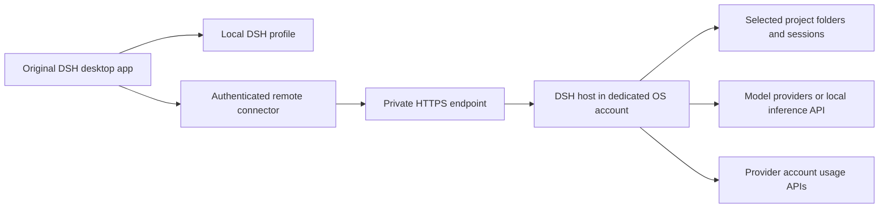

# DSH Remote Essentials

A small, version-pinned setup for using the original DeepSeek Harness desktop app with a private remote DSH host.

**Preview · source installation · not published to npm.** This repository composes three independently maintained plugins. It does not fork the DSH app or install a new background service. Native remote connection verified with DSH **0.2.2-rc.2**; the complete bundle requires a compatibility check for each DSH update.

## What you get

- One-click **Local / Remote** switching within the original desktop window.
- Compact **Claude / Codex account usage**, with reset countdown and exact local reset date in a tooltip. When figures are unavailable, the same panel keeps its provider and quota labels with empty rings and “—” values; the explanation stays in its tooltip.
- **More → Import Sessions** for selective history imports, with project grouping and path remapping supported by the importer. Importing history does not copy project files or synchronize future conversations back to the original tool.

| Install on | Contents |
|---|---|
| Desktop client | Host switcher, usage widget, frontend-only importer companion |
| Remote host | Usage backend and session importer; no host switcher |

## Architecture



The desktop loads the UI; remote API requests and imports execute on the selected host. Credentials belong to their owning host. The connector does not include an SSH daemon, VPN or cloud relay. Network access and the remote DSH service must already exist.

## Install

Start with the official DSH app and its `dsh` command. For the initial preview, clone this repository and use the local bundle directories. Review the pinned revisions in `plugins.json` before installation.

```sh
git clone https://github.com/pepuscz/dsh-remote-essentials.git
cd dsh-remote-essentials
node scripts/check.mjs
```

**Desktop client**, in the OS account that runs the desktop app:

```sh
node scripts/install.mjs client
```

**Remote host**, in the dedicated OS account and on the machine that runs it:

```sh
node scripts/install.mjs host
```

The setup command installs pinned components directly, then a configuration-only role bundle. This preserves DSH's protection against Git dependencies nested inside packages. No npm publication is required.

Open the desktop app once to initialize its profile, then fully quit it before installing the client. `desktop` and `web` are the default profile names; pass a profile name as the second argument to select another. Restart the relevant app/service afterward. The configuration tarball is retained under `$DSH_HOME/bundle-artifacts` (default `~/.dsh/bundle-artifacts`) so reinstalling from the profile lockfile can still find it. The command refuses profiles that already contain any of these components, so existing installations must be reviewed rather than overwritten. Installation is sequential, not transactional: if a step fails, inspect the profile before retrying.

Installing does not create accounts, change file permissions, sign into providers, import sessions, or expose a port. Local mode is initially selected; the client has no configured remote hosts.

### Connect your host

Keep the DSH application listener on loopback. For access over a private network, place a certificate-verified HTTPS endpoint in front of it and connect each client to that private network. Save the host pairing token in a file **owned by the client OS user and readable only by that user** (mode `0600`); never paste it into a repository or browser URL. The connector obtains its session cookie internally and saves it in that owner-only file, bound to the configured origin. The server-issued session survives ordinary host/client restarts; its expiry remains controlled by DSH and requires re-pairing when expired or revoked.

Merge this row into the desktop profile's own `cordis.patch.yml`, replacing the example port and token-file path:

```yaml
- id: personal-remote-connector
  config:
    hosts:
      - id: remote
        label: Remote
        origin: https://development.example:19443
        tokenFile: /absolute/path/to/private/host-token
```

Set `origin` to your private HTTPS endpoint. Configure the exact hostname and port on the DSH host using its official `--trusted-host` option. Certificates and hostnames are verified normally; there is no insecure TLS mode. Keep the application and private entry point off public interfaces.

Sign into the desired providers on the remote host. The usage plugin reuses the host's supported DSH OAuth records; subscriptions and provider credentials are not included in this bundle. Prefer an independent provider login for each host over copying rotating refresh tokens.

### Import selectively

1. Copy only the chosen history exports and project folders into host-accessible storage.
2. Switch the desktop to Remote, then open **More → Import Sessions**.
3. Preview and choose sessions before importing. Map old project paths to destination paths as needed.

Do not give the host access to an entire personal home directory just to migrate a few projects. Original transcript files can remain untouched; avoid the importer's source-delete actions unless deliberately requested.

## Security and updates

Read [SECURITY.md](SECURITY.md) before sharing a host. This is a **trusted single-owner setup**, not a multi-tenant security boundary.

- All three direct plugin sources are pinned to full Git commit hashes.
- The composition contains no install lifecycle scripts and adds no implementation dependency beyond the selected plugins.
- The connector and usage fork add no npm runtime dependencies. The importer uses `fzstd` pinned to `0.1.1`; DSH and its dependency tree remain part of the trusted runtime.
- No credentials, machine identities, personal paths, histories or local endpoints are distributed here.
- Update `plugins.json` deliberately after reviewing changes and testing both host and client. Keep the prior revision for rollback.

The forks retain the upstream package names so their public integration contracts remain compatible. Git URLs in `plugins.json` select our reviewed forks; installing an upstream npm package with the same name is a different artifact.

## Components and upstreams

| Component | Maintained source | Origin |
|---|---|---|
| Remote connector | [deepseek-harness-minimal-remote](https://github.com/pepuscz/deepseek-harness-minimal-remote) | Original plugin |
| Usage widget | [dsh-deepseek-usage](https://github.com/pepuscz/dsh-deepseek-usage) | [dougen/dsh-deepseek-usage](https://github.com/dougen/dsh-deepseek-usage) |
| Importer | [dsh-chat-import](https://github.com/pepuscz/dsh-chat-import) | [Nwflower/dsh-chat-import](https://github.com/Nwflower/dsh-chat-import) |

Composition files are MIT licensed. Each dependency retains its own license. This project is independent of DeepSeek, Anthropic and OpenAI.

## Compatibility boundaries

This is a source-install preview, not an automatic machine provisioner. Native remote connection, Local/Remote switching and reconnection after a host restart are checked. A fresh installation on a second machine still needs end-to-end verification. Native OS integrations may execute on the client; media and artifact behavior are not fully qualified across machines.
